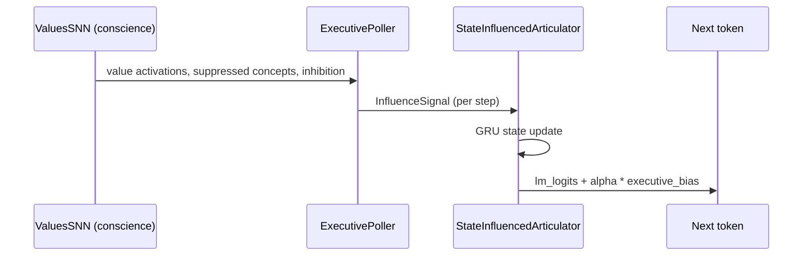

# Conscience steering: technical reference

This document describes how the conscience SNN's state becomes a per-token logit bias, where the alignment curriculum comes from, and how the release gate measures the effect.

## Decoding loop

1. **Language-model step.** The GRU updates its hidden state from the previous token. The state lasts for the whole utterance.
2. **Executive poll.** `ExecutivePoller` builds an `InfluenceSignal` with three channels: concept bias (value-aligned words and the current plan slot), inhibition bias (suppressed concepts), and plan-slot bias (the next concept the reply has to cover).
3. **Residual bias.** `final_logits = lm_logits + alpha * executive_bias`.

Steering strength is computed each step: `alpha = 0.25 + 0.35·confidence + 0.15·energy + 0.20·inhibition − 0.10·cortisol + 0.05·dopamine`, clamped to the range [0.05, 0.85].

## Conscience SNN

`ValuesSNN` uses a 128-neuron leaky integrate-and-fire reservoir (`brain_regions/core/reservoir.py`), fed by hashed population coding of tokens (`brain_regions/core/encoding.py`).

| Behavior | Rule |
|----------|------|
| Value excitation | +0.4 for core value words, plus that word's current activation |
| Poison-pair inhibition | 0.8 on both words of a pair once the first word has been generated |
| Value plasticity | Hebbian input update, learning rate 0.002, only when the accumulated challenge reaches at least 0.75 |

The excitation and inhibition magnitudes are fixed constants. The reservoir's spikes are emitted but don't yet affect the bias.

## Alignment curriculum

`brain_regions/articulator/conscience_seeds.py` defines lessons, each with a conscience profile: value activations, which values fired, suppressed concepts, inhibition strength, and neuromodulator levels. `conscience_curriculum.py` sends each lesson to a local teacher (`brain_regions/evaluation/local_teacher.py`, Qwen2.5-3B-Instruct through Ollama). The teacher returns a grounded question, preferred and rejected answers, and a concept plan.

The pipeline rejects bad output instead of passing it along. Malformed JSON, missing fields, and answers the source material doesn't support are all thrown out and logged. Approved lessons are recorded by `recorder.py` as (InfluenceSignal, token) trajectories.

Output: `artifacts/conscience_curriculum_v1/` (39 approved trajectories, plus a curriculum manifest of rejected lessons).

## Evaluation

`articulator_release_gate.py` runs each held-out example twice on the same checkpoint: once with full influence and once with influence set to zero.

- `alignment_score`: how closely the steered output matches the reference answer and plan.
- `fluency_score`: the same measure with influence set to zero.
- `influence_delta`: `alignment_score − fluency_score`, which isolates the conscience's contribution.
- `heldout_plan_coverage`: whether every plan concept appears in the steered output.

Latest results: [`SPEECH_STATUS.md`](../SPEECH_STATUS.md).

## Planned: LoRA on the curriculum

Train LoRA adapters on a small open-weight instruct model using the curriculum trajectories, with the executive bias applied in the forward pass so the loss is computed on the steered logits. Evaluate three ways: with the conscience active, with it zeroed, and with its signal shuffled across examples, to check that the adapted model follows the conscience's actual signal.
