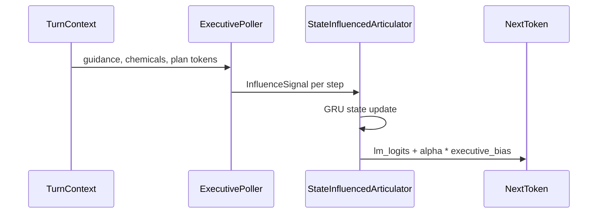

# Executive steering for a persistent decoder

This project guides an AI's reply while it is being written. A small language model writes one word at a time and remembers the whole reply so far. Before each word, a separate "executive" checks the plan for the reply and the system's current state, then gives a small push toward words that fit. This document covers the technical details: how the push is calculated, where the training examples come from, and how the results are checked.

In technical terms, the writer is a GRU (a type of recurrent neural network). The executive is a poller that turns the plan, guidance signals, and simulated chemical levels into a bounded bias added to the writer's next-word scores. The poller currently follows hand-written rules.

## Control flow

Hidden state lasts for the whole utterance. The nudge is per word. Concept, inhibition, and plan-slot channels add to vocabulary scores; strength (`alpha`) is bounded.

## Data

Bootstrap examples come from definition and conversation primers. The conscience curriculum asks a local teacher for grounded Q&A and plans; malformed teacher JSON is rejected. Approved trajectories and failed lessons are in `artifacts/conscience_curriculum_v1/`.

## Evaluation

Release script: `brain_regions/evaluation/articulator_release_gate.py`. Compare a run with influence to a run with zero influence on the same checkpoint. The last smoke train did not pass fluency and coverage gates; numbers are in [`SPEECH_STATUS.md`](../SPEECH_STATUS.md).

## Still open

A learned executive trained on the conscience JSON. Fluency of the current GRU checkpoint. Using Track C as everyday Scatterbrain speech (that switch lives in the parent repo).

## Related

- [`SPEECH_STATUS.md`](../SPEECH_STATUS.md)
- Parent project: [kmfarris/scatterbrain](https://github.com/kmfarris/scatterbrain)
