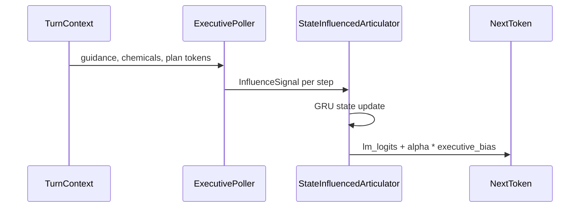

# Executive steering for a persistent decoder

Track C treats speech as **decode under influence**: a small recurrent language model holds memory across tokens; each step adds a bounded residual from an executive poll. The mesh may supply guidance elsewhere in the stack; in the published slice, `ExecutivePoller` implements rule-based logit bias from structured turn state.

## Control flow

**Persistent state.** Hidden state carries across the utterance; influence is per-token, not a one-shot prompt prefix only.

**Bias form.** Concept, inhibition, and plan-slot channels add to vocabulary logits; `alpha` is bounded per poll.

**Optional rerank.** Runtime may apply `SelectionSNN` top-k reranking among biased candidates when the full monorepo path is enabled.

## Data and curriculum

Bootstrap trajectories draw from definitional and conversational primers (`build_bootstrap_trajectories`). The conscience curriculum pairs a fail-closed local teacher with semantic-family seeds; approved trajectories and failed lessons are written to manifest JSON under `artifacts/conscience_curriculum_v1/`.

Teacher boundary: `brain_regions/evaluation/local_teacher.py` — malformed or ungrounded teacher JSON rejects without silent fallback.

## Evaluation

Release gate: `brain_regions/evaluation/articulator_release_gate.py`. Held-out families include definitional and conversational slices. Smoke training has not cleared all gates (repetition collapse documented in `SPEECH_STATUS.md`).

Ablation contract: compare full influence against zero-influence decode on the same checkpoint and tokenizer.

## Scope boundaries

| In scope | Out of scope for this repo slice |
|----------|----------------------------------|
| Influence tensor contract and JSON poll roundtrip | Training the mesh executive on conscience JSON |
| Conscience trajectory dataset methodology | Human-quality open-domain speech |
| Pytest coverage for poller, curriculum, teacher | “Jailbreak-proof” or prompt-injection claims |

## Related reading

- [`SPEECH_STATUS.md`](../SPEECH_STATUS.md) — which path runs in production
- [`docs/PORTFOLIO.md`](PORTFOLIO.md) — how this tree relates to the public extract
