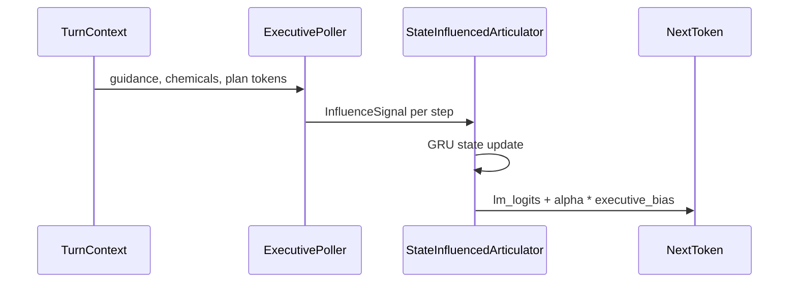

# Executive steering for a persistent decoder

Track C’s purpose is to **write a reply while a separate executive signal is still in the loop**. A small recurrent language model (GRU) remembers the sentence as it grows. At each word, a poller reads the turn’s plan, guidance, and chemical levels and adds a bounded nudge to the model’s scores for the next word.

The poller here is a designed rule over that turn state. The contract is the influence tensor and the decoder that consumes it.

## Control flow

Hidden state lasts for the whole utterance. The nudge is per word. Concept, inhibition, and plan-slot channels add to vocabulary scores; strength (`alpha`) is bounded.

## Data

Bootstrap examples come from definition and conversation primers. The conscience curriculum asks a local teacher for grounded Q&A and plans; malformed teacher JSON is rejected. Approved trajectories and failed lessons are in `artifacts/conscience_curriculum_v1/`.

## Evaluation

Release script: `brain_regions/evaluation/articulator_release_gate.py`. Compare a run with influence to a run with zero influence on the same checkpoint. The last smoke train did not pass fluency and coverage gates; numbers are in [`SPEECH_STATUS.md`](../SPEECH_STATUS.md).

## Still open

A learned executive trained on the conscience JSON. Fluency of the current GRU checkpoint. Using Track C as everyday Scatterbrain speech (that switch lives in the parent repo).

## Related

- [`SPEECH_STATUS.md`](../SPEECH_STATUS.md)
- Parent project: [kmfarris/scatterbrain](https://github.com/kmfarris/scatterbrain)
